# Project: Trestle

Trestle gives you reusable workflows in OpenCode to turn rough briefs into actionable plans, build and review changes, investigate failures, and carry decisions and context into future sessions.

```text
  ┌───┬───┬───┬───┬───┬───┬───┐
  │ T │ R │ E │ S │ T │ L │ E │ v0.1.0
  └───┴───┴───┴───┴───┴───┴───┘
  Software engineering skills for OpenCode
```

Unlike generic prompts that jump straight to writing code, these skills enforce **diagnostic discipline**, **verification steps**, **blast-radius checks**, **code density**, **terse execution**, and **knowledge preservation**.

## Related OpenCode projects

See [Structural](https://john.mariquit.com/#tools) for a map of these tools and how they fit into an OpenCode workflow.

- [Truss](https://github.com/mariquit/truss): Plugins for OpenCode
- [Lattice](https://github.com/mariquit/lattice): Semantic codebase wiring for OpenCode
- [Span](https://github.com/mariquit/span): Contextual aggregate memory mesh for OpenCode
- [Formwork](https://github.com/mariquit/formwork): Spec-driven agent for solo developers on OpenCode
- [Catwalk](https://github.com/mariquit/catwalk): Terminal viewer for agent-owned TODO lists

## Skill Overview

| Skill | Trigger / Command | Focus & Core Philosophy |
| :--- | :--- | :--- |
| [adr](adr.md) `v0.1.0` | `/adr`<br>`"document why we chose this architecture"` | **Decision Provenance.** Extracts lightweight Architecture Decision Records from chat history, emphasizing the negative space (what options were rejected and why). |
| [de-slop](de-slop.md) `v0.1.0` | `/de-slop [--review]`<br>`"clean up this prose/doc"` | **Prose editing.** Rewrites prose or reviews it without editing. Review can use a bundled lint helper for cited style findings. |
| [deconstruct](deconstruct.md) `v0.1.0` | `/deconstruct`<br>`"write down how we figured this out"` | **Knowledge Capture.** Mines the active session to extract the diagnostic path, dead ends, and core breakthrough into a durable playbook rather than a simple commit fix. |
| [dive-deep](dive-deep.md) `v0.1.0` | `/dive-deep`<br>`"interrogate this brief before we build"` | **Requirements Discovery.** Asks one consequential question per turn before implementation. Records agreed requirements, non-goals, and observable acceptance criteria without turning open decisions into defaults. |
| [frontend](frontend.md) `v0.2.0` | `/frontend`<br>`"design a mobile-friendly web interface"` | **Frontend Design.** For HTML-first sites and apps such as [Astro](https://astro.build/) and [FastHTML](https://fastht.ml/). Uses [Basecoat UI](https://basecoatui.com/introduction/) when no design system is established. React, Vue, and Svelte are out of scope. Requires the [OpenCode V2 plugin](plugins/frontend/README.md) for session checkpoints and post-edit lint. |
| [frontend-react](frontend-react.md)  `v0.1.0` | `/frontend-react`<br>`"design a Vite React interface"` | **Vite + React Design.** Uses standard [shadcn/ui](https://ui.shadcn.com/docs) and requires the [OpenCode V2 plugin](plugins/frontend-react/README.md) for discovery, planning, and verification. Other React frameworks and routers are out of scope. |
| [github-pr-review](github-pr-review.md)  `v0.1.0` | `/github-pr-review`<br>`"review this GitHub PR"` | **Pull Request Review.** Reviews a GitHub PR or local branch diff and returns a verdict, prioritized findings, and verification gaps. Does not post to GitHub unless asked. |
| [hand-over](hand-over.md) `v0.1.0` | `/hand-over`<br>`"hand this work over to a fresh session"` | **Session Continuity.** Saves work in progress, decisions, and verification evidence in a versioned checkpoint. Checks the revision and file contents for drift without changing the checkout before resuming. |
| [improve](improve.md)  `v0.1.0` | `/improve`<br>`"sharpen this prompt"` | **Prompt Refinement & Scoped Execution.** Puts scope limits and stop conditions in the rewritten prompt, or applies them directly when executing a task. |
| [integration-seam](integration-seam.md) `v0.1.0` | `/integration-seam`<br>`"prove this integration through its caller"` | **Boundary Justification.** Keeps the capability in-process unless a concrete constraint requires a new boundary. Defines the contract and verifies both success and a meaningful failure through the real caller. |
| [post-mortem](post-mortem.md)  `v0.1.0` | `/post-mortem`<br>`"investigate this incident"` | **Incident Investigation.** Correlates incident records, deployments, commits, and telemetry in a standalone HTML report that separates evidence from inference and tracks remediation. |
| [pre-flight](pre-flight.md) `v0.1.0` | `/pre-flight`<br>`"audit these changes"` | **Blast-Radius Analysis.** Audits the boundary between your git diff and the rest of the codebase to catch broken invariants and unseen caller regressions. |
| [regression-test](regression-test.md) `v0.1.0` | `/regression-test`<br>`"write a test that proves this fix"` | **Isolated Regression Proof.** Runs the same regression test against explicit unfixed and fixed refs in separate worktrees, then records the verdict. |
| [release-size](release-size.md) `v0.1.0` | `/release-size`<br>`"reduce this release artifact size"` | **Measured Release Optimization.** Compares exact bytes for one shipped artifact built through the release pipeline. Counts savings as verified only after checking affected behavior from the packaged deliverable on the target. |
| [scaffold](scaffold.md)  `v0.1.0` | `/scaffold`<br>`"choose a stack"` | **Stack Selection.** Recommends a stack for a site, app, or API based on requirements, hosting constraints, and what the project can reuse. |
| [spike](spike.md) `v0.1.0` | `/spike`<br>`"prove this with a small experiment"` | **Timeboxed Experimentation.** Tests one falsifiable architectural hypothesis outside the active checkout. Keeps the evidence and reproduction steps, not the prototype. |
| [tech-writer](tech-writer.md) `v0.1.0` | `/tech-writer`<br>`"refine technical source data"` | **Technical Data Editing.** Rephrases conversational fluff and enriches hyper-terse content in `.json`, `.yaml`, and `.md` source files to meet Operational Completeness standards while preserving schema integrity. |
| [terse](terse.md) `v0.1.0` | `/terse [on \| off \| <task>]`<br>`"switch to terse mode"` | **Execution Mode Control.** Toggles high-density, direct agent execution mode. Bypasses preambles, outputs atomic changes, and enforces concise terminal communication. |
| [triage](triage.md) `v0.1.0` | `/triage`<br>`"debug this systematically"` | **Structured Isolation.** Enforces a diagnostic freeze before modifying application code. Uses zero-mutation checks to test falsifiable hypotheses. |
| [what-is-next](what-is-next.md) `v0.1.0` | `/what-is-next`<br>`"pick the next action"` | **Evidence-Based Prioritization.** Uses the current goal and checkout evidence to recommend one action that clears the nearest blocker. Recommends the action without executing it or changing the checkout. |

## Install

From a local copy of the repository, run `./install.sh` to select skills in a terminal menu. The installer requires Node.js 24 or later on a Unix-like system. It does not require Python.

```sh
./install.sh                         # Open the selection menu
./install.sh dive-deep hand-over     # Install specific skills
./install.sh --all                   # Install all 20 skills
./install.sh --upgrade dive-deep     # Back up and replace a differing install
```

The default destination is `$XDG_CONFIG_HOME/opencode/skills`, or `~/.config/opencode/skills` when `XDG_CONFIG_HOME` is unset. Use `--skills-dir PATH` or set `OPENCODE_SKILLS_DIR` to override it. In OpenCode, use `@skill-id` to load an installed skill.

Selecting `frontend` or `frontend-react` installs its required plugin. OpenCode V2 discovers the `trestle-<skill>.ts` entry points in `$XDG_CONFIG_HOME/opencode/plugins/` (default: `~/.config/opencode/plugins/`). The plugin code and locked runtime dependencies live in the sibling `trestle-plugins/` directory. No JSON or JSONC file is changed. Plugin installation requires npm. `--skills-dir` alone does not redirect the global plugin installation. Use `--upgrade` to migrate an older directory-only installation; the installer backs up the old plugin directory.

For a release install without cloning, download and inspect the launcher before running it. This requires `curl` and `tar` in addition to Node.js. The release assets must be published first.

```sh
curl -fsSL -o install.sh https://github.com/mariquit/trestle/releases/latest/download/install.sh
less install.sh
sh install.sh frontend frontend-react
```

To stream the launcher instead, run `curl -fsSL https://github.com/mariquit/trestle/releases/latest/download/install.sh | sh`. A streamed install without arguments selects all skills. Pass explicit IDs with `sh -s -- frontend frontend-react` to select only those two. The release's SHA-256 checksum verifies the downloaded bundle before extraction; it is not a signature.

Selecting `de-slop` copies a bundled helper to `<skills-dir>/de-slop/scripts/lint.mjs`. The helper does not need npm or network access. Run `node tools/de-slop/bundle/lint.mjs README.md` from the checkout to scan a file directly. The output is advisory JSON, not an authorship assessment. The skill can review prose manually if it cannot run the helper.

Identical installs are skipped. Upgrades require `--upgrade` and print the backup location. The installer refuses live skill links; see [legacy link recovery](CONTRIBUTING.md#recover-legacy-live-links) if an old link or backup blocks installation.

---

## SDLC Toolkit Mapping

Skills are grouped by what they primarily deliver, not by when they can be used. Some span several stages: the frontend skills plan, implement, and verify interfaces, while `/scaffold` recommends a stack without writing code.

- **Requirements & Architecture:** Use `/dive-deep` to agree on requirements and acceptance criteria, `/scaffold` to recommend a technology stack, `/spike` to resolve an architectural unknown with a throwaway experiment, and `/adr` to record a decision and its trade-offs.
- **Frontend Design & Implementation:** Use `/frontend` for HTML-first interfaces and `/frontend-react` for Vite + React interfaces. Both guide design, implementation, and verification of the rendered UI.
- **Debugging & Investigation:** Use `/triage` to isolate a bug's cause through read-only diagnostics before changing code. Use `/post-mortem` to reconstruct an incident from deployment and runtime evidence and document findings and follow-up in a local HTML report.
- **Integration, Testing & Review:** Use `/integration-seam` to justify a boundary, define its contract, wire it, and verify success and failure through the real caller. Use `/regression-test` to prove a fix against unfixed and fixed refs, `/pre-flight` to audit spec alignment and effects beyond the diff, and `/github-pr-review` to return prioritized findings and a merge recommendation for a PR or local branch.
- **Release Engineering:** Use `/release-size` to reduce one packaged artifact and verify its behavior on the target.
- **Documentation & Knowledge Capture:** Use `/de-slop` to edit or audit prose, `/tech-writer` to clarify technical instructions without changing their schema, and `/deconstruct` to turn a completed investigation into a reusable playbook.
- **Task & Session Workflow:** Use `/improve` to sharpen a prompt without expanding it or execute a task within its original scope, `/what-is-next` to recommend the next action without executing it, `/hand-over` to save or resume a checkpoint with drift checks, and `/terse` to change the agent's execution and communication mode across domains.

```mermaid
graph TD
    subgraph SDLC ["Software Engineering Domains"]
        direction TB

        subgraph S1 ["Requirements & Architecture"]
            Brief[Unresolved Requirements] --> DiveDeep[/"/dive-deep"\]
            Slice[Technology Stack Decision] --> Scaffold[/"/scaffold"\]
            Unknown[Architectural Unknown] --> Spike[/"/spike"\]
            A[Architecture Decision Record] --> B[/"/adr"\]
        end

        subgraph S7 ["Frontend Design & Implementation"]
            O[HTML-first UI] --> P[/"/frontend"\]
            Vite[Vite and React UI] --> ReactUI[/"/frontend-react"\]
        end

        subgraph S2 ["Debugging & Investigation"]
            C[Complex Bug Reported] --> D[/"/triage"\]
            Incident[Incident Evidence and Remediation] --> PostMortem[/"/post-mortem"\]
        end

        subgraph S4 ["Integration, Testing & Review"]
            Caller[Boundary Contract and Caller Verification] --> Seam[/"/integration-seam"\]
            I[Regression Proof Across Two Refs] --> J[/"/regression-test"\]
            K[Pre-PR Change Audit] --> L[/"/pre-flight"\]
            PullRequest[Pull Request Review] --> PRReview[/"/github-pr-review"\]
        end

        subgraph S5 ["Release Engineering"]
            Artifact[Packaged Artifact Size] --> ReleaseSize[/"/release-size"\]
        end

        subgraph S3 ["Documentation & Knowledge Capture"]
            G[Prose Editing or Audit] --> H[/"/de-slop"\]
            Q[Technical Source Files & Runbooks] --> R[/"/tech-writer"\]
            M[Reusable Investigation Playbook] --> N[/"/deconstruct"\]
        end

        subgraph S6 ["Task & Session Workflow"]
            Prompt[Prompt Refinement or Scoped Execution] --> Improve[/"/improve"\]
            Priority[Next Action Recommendation] --> WhatIsNext[/"/what-is-next"\]
            Checkpoint[Work-in-Progress Checkpoint] --> HandOver[/"/hand-over"\]
            E[Agent Execution Mode] --> F[/"/terse"\]
        end
    end

    classDef skill fill:#1fa9d7,stroke:#bae6fd,stroke-width:2px,color:#fff;
    class B,D,F,H,J,L,N,P,R,ReactUI,DiveDeep,Spike,Seam,Scaffold,ReleaseSize,WhatIsNext,HandOver,Improve,PostMortem,PRReview skill;

    style SDLC fill:none,stroke:#334155,stroke-width:1px,stroke-dasharray: 5 5,color:#9ba5b1

    %% Subgraph Styling
    classDef domain fill:#1e293b,stroke:#475569,stroke-width:1px,color:#f8fafc
    class S1,S2,S3,S4,S5,S6,S7 domain;

```



---

## License

Copyright (c) 2026 John Anthony Mariquit [john@mariquit.com](mailto:john@mariquit.com)

This project is licensed under the Apache License, Version 2.0. See [LICENSE](./LICENSE) for the full text.

## Contributing

Contributions are welcome! Please read our [CONTRIBUTING.md](./CONTRIBUTING.md) guide for details on skill-writing guidelines, validation, and the pull request process.
