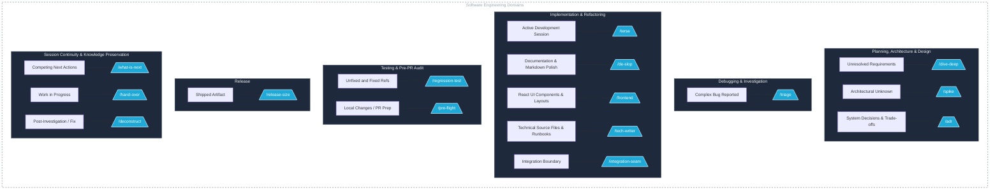

# Project: Trestle

A collection of verification-focused `SKILL.md` specifications designed for OpenCode.

```text
  ┌───┬───┬───┬───┬───┬───┬───┐
  │ T │ R │ E │ S │ T │ L │ E │ v0.1.0
  └───┴───┴───┴───┴───┴───┴───┘
  Software engineering skills for OpenCode
```

Unlike generic prompts that jump straight to writing code, these skills enforce **diagnostic discipline**, **verification steps**, **blast-radius checks**, **code density**, **terse execution**, and **knowledge preservation**.

## Related OpenCode projects

See [Structural](https://john.mariquit.com/#tools) for a map of these tools and how they fit into an OpenCode workflow.

- [Truss](https://github.com/mariquit/truss): Plugins for OpenCode
- [Lattice](https://github.com/mariquit/lattice): Semantic codebase wiring for OpenCode
- [Span](https://github.com/mariquit/span): Contextual aggregate memory mesh for OpenCode
- [Formwork](https://github.com/mariquit/formwork): Spec-driven agent for solo developers on OpenCode
- [Catwalk](https://github.com/mariquit/catwalk): Terminal viewer for agent-owned TODO lists

## Skill Overview

| Skill | Trigger / Command | Focus & Core Philosophy |
| :--- | :--- | :--- |
| [adr](adr.md) `v0.1.0` | `/adr`<br>`"document why we chose this architecture"` | **Decision Provenance.** Extracts lightweight Architecture Decision Records from chat history, emphasizing the negative space (what options were rejected and why). |
| [de-slop](de-slop.md) `v0.1.0` | `/de-slop`<br>`"clean up this prose/doc"` | **Document Refactoring.** Purges AI slop, structural fluff, meta-commentary, and passive abstract agency from markdown text and documents. |
| [deconstruct](deconstruct.md) `v0.1.0` | `/deconstruct`<br>`"write down how we figured this out"` | **Knowledge Capture.** Mines the active session to extract the diagnostic path, dead ends, and core breakthrough into a durable playbook rather than a simple commit fix. |
| [dive-deep](dive-deep.md) `v0.1.0` | `/dive-deep`<br>`"interrogate this brief before we build"` | Resolve requirements one decision at a time before writing code. |
| [frontend](frontend.md) `v0.1.0` | `/frontend`<br>`"build a mobile-friendly React interface"` | **Frontend Guidance.** Uses DaisyUI components and Tailwind CSS layouts for consistent React interfaces, with attention to content hierarchy, responsive design, accessibility, and existing project conventions. |
| [hand-over](hand-over.md) `v0.1.0` | `/hand-over`<br>`"hand this work over to a fresh session"` | Save work in progress or check a checkpoint for drift before resuming. |
| [integration-seam](integration-seam.md) `v0.1.0` | `/integration-seam`<br>`"prove this integration through its caller"` | Justify a boundary and verify success and failure through the real caller. |
| [pre-flight](pre-flight.md) `v0.1.0` | `/pre-flight`<br>`"audit these changes"` | **Blast-Radius Analysis.** Audits the boundary between your git diff and the rest of the codebase to catch broken invariants and unseen caller regressions. |
| [regression-test](regression-test.md) `v0.1.0` | `/regression-test`<br>`"write a test that proves this fix"` | **Isolated Regression Proof.** Runs the same regression test against explicit unfixed and fixed refs in separate worktrees, then records the verdict. |
| [release-size](release-size.md) `v0.1.0` | `/release-size`<br>`"reduce this release artifact size"` | Measure savings in one shipped artifact and verify affected behavior on target. |
| [spike](spike.md) `v0.1.0` | `/spike`<br>`"prove this with a small experiment"` | Test one architectural hypothesis in scratch space and discard the prototype. |
| [tech-writer](tech-writer.md) `v0.1.0` | `/tech-writer`<br>`"refine technical source data"` | **Technical Data Editing.** Rephrases conversational fluff and enriches hyper-terse content in `.json`, `.yaml`, and `.md` source files to meet Operational Completeness standards while preserving schema integrity. |
| [terse](terse.md) `v0.1.0` | `/terse [on \| off \| <task>]`<br>`"switch to terse mode"` | **Execution Mode Control.** Toggles high-density, direct agent execution mode. Bypasses preambles, outputs atomic changes, and enforces concise terminal communication. |
| [triage](triage.md) `v0.1.0` | `/triage`<br>`"debug this systematically"` | **Structured Isolation.** Enforces a diagnostic freeze before modifying application code. Uses zero-mutation checks to test falsifiable hypotheses. |
| [what-is-next](what-is-next.md) `v0.1.0` | `/what-is-next`<br>`"pick the next action"` | Pick one finish-first action without changing the checkout. |

## Install

From a local copy of the repository, run `./install.sh` to select skills in a terminal menu. The installer requires Python 3.10+ on a Unix-like system.

```sh
./install.sh                         # Open the selection menu
./install.sh dive-deep hand-over     # Install specific skills
./install.sh --all                   # Install all 15 skills
./install.sh --upgrade dive-deep     # Back up and replace a differing install
```

The default destination is `$XDG_CONFIG_HOME/opencode/skills`, or `~/.config/opencode/skills` when `XDG_CONFIG_HOME` is unset. Use `--skills-dir PATH` or set `OPENCODE_SKILLS_DIR` to override it. In OpenCode, use `@skill-id` to load an installed skill.

Identical installs are skipped. Upgrades require `--upgrade` and print the backup location. The installer refuses live skill links; see [legacy link recovery](CONTRIBUTING.md#recover-legacy-live-links) if an old link or backup blocks installation.

---

## SDLC Toolkit Mapping

These skills act as modular power tools invoked at specific stages of the Software Development Life Cycle:

- **Planning, Architecture & Design:** Use `/dive-deep` to resolve requirements before implementation, `/spike` to test an architectural unknown, and `/adr` to record the decision and its trade-offs.
- **Debugging & Investigation:** Run `/triage` at the start of a complex incident to enforce a hypothesis-driven freeze before changing code.
- **Implementation & Refactoring:** Use `/integration-seam` to justify a boundary and verify it through the real caller, `/frontend` for React interfaces with DaisyUI and Tailwind CSS, `/terse` for concise execution, `/de-slop` to edit prose, and `/tech-writer` to refine technical source files.
- **Testing & Pre-PR Audit:** Use `/regression-test` to prove a fix against unfixed and fixed refs in separate worktrees, and `/pre-flight` to check the blast radius of a change beyond the diff.
- **Release:** Use `/release-size` to measure and verify changes to a shipped artifact.
- **Session Continuity & Knowledge Preservation:** Use `/what-is-next` to pick one finish-first action, `/hand-over` to save or resume work in progress, and `/deconstruct` to turn a completed investigation into a reusable playbook.



---

## License

Copyright (c) 2026 John Anthony Mariquit [john@mariquit.com](mailto:john@mariquit.com)

This project is licensed under the Apache License, Version 2.0. See [LICENSE](./LICENSE) for the full text.

## Contributing

Contributions are welcome! Please read our [CONTRIBUTING.md](./CONTRIBUTING.md) guide for details on skill-writing guidelines, validation, and the pull request process.
